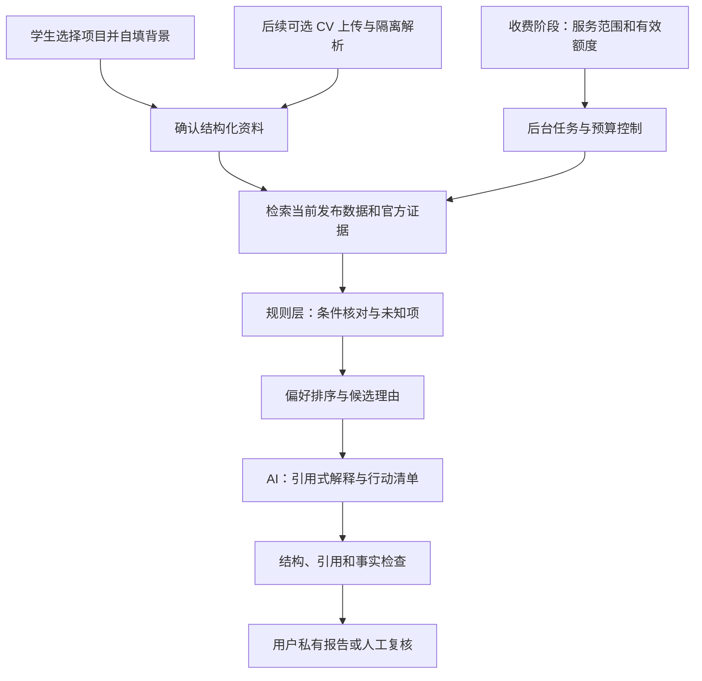

# Study in China Atlas：推广与商业化路线

日期：2026-10-17（Asia/Shanghai）。状态：供项目负责人评审和执行的方案；价格、受众和阶段门槛是实验假设，不是已上线功能或市场验证结论。

## 1. 产品要解决的任务

让准备来华学习的国际学生，从“找到一些学校”走到“知道自己应当申请哪些项目、为什么、缺少什么、下一步怎么做”。

免费目录解决信息分散；未来付费服务解决个人决策和准备工作的复杂性。公开来源、准确性与纠错能力不能变成付费特权。AI 与数据库是实现成本，学生购买的应当是节省的核对时间、减少的申请错误和可执行的计划。

当前处于“已有发现与比较产品，尚未验证付费问题”的阶段。推荐先验证一个窄人群的一项任务，再扩大覆盖。用户规模、点赞和注册数都不能单独成为开发付费系统的理由。

## 2. 已知事实与尚待验证的判断

### 仓库已经具备

- 项目、大学、城市与奖学金目录；筛选链接、设备内收藏、最多四项目比较、官方来源及不确定性状态。
- 多语言路由、canonical、hreflang、站点地图、分享预览图，以及 Vercel 访问和性能统计组件。
- 发布门槛和字段新鲜度保护；有完整的数据工程设计，但不能将所有基础设施实现视为生产环境已证明。
- 现有反馈表单；是否能在生产成功送达，还需要实际配置与端到端验证。

仓库目前把网站描述为独立、非商业目录，并说明不接收申请材料。付费档案服务是未来边界变化；在正式启用前，必须同步更新公开介绍、服务范围、隐私与退款条款。

### 本地数据对首轮范围的约束

按 2026-10-17 调用现有发布函数，本地工作树有 753 个当前公开项目，集中在 6 所大学；其中硕士 346、博士 352。大学目录身份共有 255 个，不能据此宣称这些学校都有当前可匹配的招生条件。奖学金当天通过同一发布门槛的数量为 0。

这些是本地数据结果，不是线上可用性审计；通过发布门槛也不等于申请窗口正在开放。详见[数据准备度与复现方法](./matching-readiness-2026-10-17.md)。

因此，第一批付费分析应覆盖“明确列出的学校、专业、入学季”，逐个重新复核。先不要宣传全国精准匹配、全奖推荐或录取预测。

### 竞争事实

| 官方资料 | 可确认的事实 | 对我们的设计意味着什么 |
|---|---|---|
| [Studyportals Sophia](https://studyportals.com/meet-ai-student-advisor/) | 注册用户已有免费 AI 顾问入口，可结合背景、语言和预算提供个性化指导 | 普通聊天和泛化匹配存在免费替代品；差异化要落在中国项目的条件证据和申请行动上 |
| [China Admissions 支持中心](https://www.china-admissions.com/support/)与[当期咨询服务](https://www.china-admissions.com/2026-2027-services-1/) | 基础服务有大学资助；另提供个人背景及材料咨询 | 免费发现、人工支持已有市场供给；必须明确服务交付和资助关系 |
| [CUCAS 服务说明](https://www.cucas.edu.cn/server/details?id=589&lang=en) | 服务费与大学申请费分别存在；页面标价与具体项目结算需分别核对 | 我们的服务费、学校申请费与学费必须清楚分列；不把历史页面价格当现价 |

这是供给侧研究，不能证明学生一定愿意购买我们的报告，也不构成竞品推荐存在偏差的证据。没有用历史来华留学生总数推算收入：付费对象应是当前有申请任务、可触达、在覆盖范围内且愿意购买的人。

## 3. 首批服务谁

初始假设：未来 6–12 个月准备申请中国英语授课硕士、已有本科背景、需要同时考虑专业与预算的国际学生。这个群体是否最佳，需要访谈和项目数据共同确认；若相关项目证据不足，先调整范围。

为什么暂不覆盖所有人：本科、博士导师选择、语言进修、交换和奖学金有不同的决策过程。博士尤其涉及导师意愿和名额，不能用硕士的匹配逻辑直接复制。

第一批可交付范围：一个专业方向、约 20–30 个经过复核的项目。若不能凑齐，不凑数量；缩小试点并展示覆盖清单。选择先导国家或地区，应依据访谈来源、语言与实际渠道转化，而不是假定某国学生更愿意付费。

## 4. 免费与收费的边界

| 层级 | 学生获得什么 | 收费假设与启用条件 |
|---|---|---|
| 免费发现 | 搜索筛选、官方链接、基本比较、收藏、来源和过期说明、通用申请指南 | 保持可用；不以强制注册或收费阻断官方信息 |
| 免费初步检查 | 自填简短背景后，展示数据覆盖、缺失资料和一项示例核对 | 验证需求后试点；不能隐藏已发现的硬性不满足来诱导购买 |
| 一次性选校报告 | 对确认范围内的 3–5 个候选项目逐项核对条件，列出差距、待确认事项、来源和行动计划 | 优先测试按次付费；没有足够证据就说明无法交付，不为无依据结论收费 |
| 申请季套餐 | 有限次重新分析、项目变更提示、材料进度和报告历史 | 只有用户实际多次返回且更新成本可控后再做；不自动假定月订阅成立 |
| 可选人工复核 | 有明确范围和时限的复杂情况复查 | 人员能力、服务容量与成本得到验证后增加，单独说明费用 |

定价不现在拍板。若已具备合法收款与可靠交付，可以对同一明确范围顺序测试 US$9 与 US$19 的报告报价；这只是探索愿付价格的起点，不是市场均价、盈利承诺或已经对外公布的定价。记录拒绝原因和实际购买动作，不能只收集“看起来不错”。试点价格、人工参与程度、交付时限和退款条件要事先说明。

不建议一开始按调用次数卖“AI 点数”：学生更容易理解一份完成的报告。报告内可设定有限次数资料修正，避免无限生成使成本失控。

## 5. 一份值得付费的报告

报告应包含：用户确认的背景摘要、覆盖范围、已选项目核对、备选项目及原因、材料差距、未来四周行动、每个重要结论的官方证据、核查日期与适用周期。

三个维度分开展示：

1. **资格核对**：满足已核实条件／明确不满足某条件／信息不足／需官方确认。
2. **个人偏好适配**：专业、语言、预算、地点等与用户目标的一致程度及取舍。
3. **证据充分程度**：哪些字段有当前证据，哪些缺失、过期或相互冲突。

满足已核实条件不代表完整资格审核通过；偏好适配也不是录取概率。目前没有申请池、招生名额及可靠录取结果数据，不能输出“录取概率 85%”，也不能把学校排名转换成录取难度。

### 演示报告片段

以下完全是格式样例，没有真实学校、招生规则或实际申请人；正式报告必须由已复核来源替换每个示例条目。

| 核对项 | 示例输出 | 学生下一步 |
|---|---|---|
| 用户资料 | 用户填写了语言总分，未填写各单项分数 | 补充分数；不从总分推算单项 |
| 项目 A 的语言条件 | 证据要求单项门槛，但资料不足，结论为“待确认” | 核对原始成绩与有效日期 |
| 项目 B 的预算 | 仅有历史参考学费，当前费用未知 | 向官方招生处确认；暂不判定预算满足 |
| 项目 C 的前置课程 | 用户课程信息与官方条件尚不能一一对应 | 列出需核对的课程，提供官方询问清单 |

每条正式核对记录应有 `programId / cycleId / ruleId / sourceUrl / checkedAt / result / reason`。报告保存 `catalogReleaseId / profileVersion / rulesVersion / generatedAt`；后续数据变化应提示需要复核。

## 6. 推广路径：先让用户完成任务

首轮定位可用：**“Find programs in China, check the official requirements, and build a shortlist you can act on.”**

主渠道只选两个：负责人自己的英文内容页面（如 LinkedIn 或个人主页），以及已有联系、允许资源分享的国际学生社群。前者便于持续解释价值，后者便于观察真实任务和招募访谈。它们是否有效仍需测量。

内容优先回答具体问题：如何区分目录存在与申请开放；如何核对英语授课及豁免；如何比较学费、学校申请费与奖学金适用范围。每篇内容只引导一个任务，例如“筛出两个候选项目，并告诉我们还缺什么”。不要泛发“我们的 AI 留学平台上线了”。

[首批用户推广手册](./first-cohort-playbook.md)提供英文草稿、渠道链接、14 天安排和访谈提纲。群组发帖、版主联系、私信及合作外联由负责人在明确授权后执行，当前没有发送。

搜索是长期入口。已有 sitemap，后续由站点所有者验证 Search Console 并提交；Google 明确说明[提交 sitemap 不保证抓取或索引](https://developers.google.com/search/docs/crawling-indexing/sitemaps/build-sitemap)。不通过放宽薄内容索引门槛来制造页面数量。

## 7. 阶段门槛：依据证据推进

下列数字是内部实验起点，样本很小，只能帮助决定下一步，不能称为行业基准或统计证明。阶段按证据推进，不要求先达到某个注册总数。

| 阶段 | 做什么 | 建议观察与推进条件 | 未达到时怎么做 |
|---|---|---|---|
| 需求验证 | 约 20 位目标学生访谈，观察最近一次真实找项目过程 | 至少 8 人独立提到同一高成本问题，至少 5 人愿意带着真实 shortlist 试用 | 调整人群或任务，不先开发上传与支付 |
| 服务验证 | 为 5–10 位自愿者免费交付有人工复核的样例报告 | 至少 5 人能据报告完成一个可观察动作；记录交付时间与错误 | 修正报告和数据，不扩大引流 |
| 付费验证 | 基础收款、隐私、范围与退款准备好后，在明确报价下完成首批真实订单 | 先收集约 10 个已交付订单；判断购买原因、退款、复查成本和单位贡献 | 报价、范围或交付价值需调整；不把意向算成销售 |
| 自动化 | 将重复且可靠的人工步骤产品化 | 人工复核样本无未解决的严重误判；成本与质量在自动流程下仍可控 | 保留人工限定服务，减少覆盖范围 |
| 放大 | 对已表现良好的受众、主题和渠道追加投入 | 来源明确、可复现的获客与交付效果，退款及支持负担可承受 | 暂停弱渠道；不靠泛流量掩盖任务失败 |

核心指标建议为“每周完成一次有证据 shortlist 的目标申请者人数”。早期通过用户主动反馈和小样本观察记录，不能从匿名点击量直接推定。

辅助指标：目录到详情、比较使用、官方申请入口点击、主动反馈、报价到购买、报告交付成功、纠错、退款及每份人工分钟数。每个指标固定分母，例如购买转化率使用“收到同一范围明确报价的合格试点参与者”，不混用全站访问人数。

现有 Analytics 组件不等于已经测量这些行为。先核实当前套餐、启用状态和可见维度；来源标签不会自动产生转化报表。可先用平台聚合访问数据与自愿试用记录复盘，不默认启用付费自定义事件。没有账号或去重设计时，不虚报跨设备用户留存。

## 8. 功能优先级与不做清单

| 优先级 | 能力 | 为什么 |
|---|---|---|
| 现在必要 | 当前证据、清楚的筛选比较、官方路径、可用反馈、分享路径、首轮物料和手工复盘 | 决定用户能否完成找项目任务，以及我们能否学到东西 |
| 试点必要 | 小范围项目规则、简短自填背景、用户确认、报告模板、人工复核、删除与服务边界 | 先证明匹配服务的准确性和价值 |
| 收费前必要 | 认证与私有报告权限、支付状态、额度、退款、隐私告知、错误恢复、成本上限和客服入口 | 涉及个人资料与真实付费后不能依靠原型处理 |
| 有需求再做 | 简历解析、跨设备同步、持续提醒、申请季套餐、材料清单、有限人工支持 | 分别由输入负担、回访和服务需求触发 |
| 暂缓 | 泛化聊天机器人、自动写完所有文书、代投所有学校、原生 App、社交社区、大量语言扩张、复杂向量数据库 | 尚未证明它们能改善首个付费任务，会增加维护和责任 |
| 不提供 | 保录取、无数据的录取概率、隐藏返佣排序、未经允许售卖个人材料 | 与证据优先和用户信任冲突 |

合作高校、B2B 工具与数据服务可以是后续收入来源，但应等个人用户任务和维护流程跑通。若有赞助或返佣，公开披露，广告与自然结果分开；付款不得改变资格判断。公开来源可阅读不等于整份原始内容可以直接打包转售，商业数据产品还需核对授权范围。

## 9. AI 匹配系统如何设计

规则层负责可复核判断，AI 负责提取待确认资料、解释和组织计划。不能让语言模型补造最低 GPA、奖学金条件、年龄限制或语言豁免。缺失不是满足，也不是拒绝；只有相关官方规则确实需要时，才询问年龄或资格相关国籍条件。

初期用现有数据库的结构化检索缩小候选范围，不把全部目录和完整简历直接放进提示词。检索增强的含义是在生成解释前给 AI 提供相关证据；这里未必需要向量数据库，SQL 筛选、关系和明确字段通常更便于审计。统一复用公开发布与字段新鲜度合同，不从 raw JSON 绕过限制。

后续 CV 上传只是便捷输入方式，不是收费价值本身：私有对象存储、短时授权、类型和大小限制、安全解析、清理策略；提取后让用户确认。文档中的指令视为不可信内容，不允许改变系统规则或触发外部操作。

私有档案、文件和报告与公共目录及其备份权限分开，API 按用户身份校验归属。付费权益由服务器确认；支付回调签名与幂等处理，任务超时不重复扣费；失败任务可重试或恢复额度。耗时解析和报告生成放后台队列，避免浏览器断开就丢失工作；模型和人工复核都有用量上限。先设计逻辑边界，不为假想规模立即拆分大量微服务。

### 评估方式

建立人工复核样例，覆盖语言单项与豁免、GPA 原始量表、前置课程、国籍例外、年龄基准日、过期周期、冲突来源和资料缺失。先测“错误判为满足”、引用是否支持结论、关键未知是否显露、资料提取经用户修正的比例，以及是否帮助完成真实行动。

在独立留出的测试案例上检查；维护者和模型生成的自测不能代替人工核对。首批所有报告人工复核，严重资格误判未解决就不开放自动付费交付。不要为了提高覆盖率自动补齐缺失规则。

## 10. 资料、运营和成本边界

资料最小化：初期收目标学位、专业、入学季、预算、原始成绩量表和语言成绩即可；不主动收护照、健康信息或完整成绩单。访谈也允许匿名，不把个人背景放在公开 GitHub issue 或推广链接里。

《个人信息保护法》对必要范围、告知、敏感信息及跨境提供分别有要求；具体适用取决于运营主体、用户所在地、存储和模型服务链路，收费/上传前需完成针对性审查。不能因为用户来自海外，就假定其资料可以任意跨境流转。[官方法律文本](https://www.cac.gov.cn/2021-08/20/c_1631050028355286.htm)

报告标明 AI 辅助、证据时间、局限与人工参与。若服务落入相应适用范围，还需落实[生成合成内容标识要求](https://www.cac.gov.cn/2025-03/14/c_1743654684782215.htm)。保存、删除、供应商训练使用与跨境承诺必须与实际配置一致，不能先写一个做不到的隐私保证。

收费前另核实：运营和收款主体、可支持国家/币种、结算和退款能力、税费与服务条款。现有 Vercel 账户套餐本轮未检查；若使用 Hobby，它限制非商业用途，公开销售或收费前需选择允许商业使用的方案或部署方式。[Vercel 官方公平使用条款](https://vercel.com/docs/limits/fair-use-guidelines)

单份报告贡献 = 实收金额 − 退款与支付成本 − 模型/OCR/存储等变动成本 − 人工复核及客服成本。

月度经营结果还需扣除免费用户服务、内容、数据核查与固定运营成本。模型成本按实际输入/输出量、重试、解析和模型价格记录；人工时间也折算成本。数据核验通常比“一次模型调用”更容易被低估。付费投放前，先用实际订单观察贡献、获客花费和交付容量；小样本不宣称稳定的终身价值或回本率。

## 11. 接下来四周的可执行交付

1. **第 1 周：确认任务。** 完成当前线上访问/反馈检查；选一个专业方向与可核验范围；准备三篇任务型英文内容，开始招募约 20 位访谈者。
2. **第 2 周：验证用处。** 观察筛选与比较过程；整理反复出现的卡点；核查试点项目要求；为自愿者用背景表提供免费样例报告。
3. **第 3 周：验证交付。** 累计完成 5–10 份人工复核样例；记录错误、用户动作、人工分钟和缺失数据；据此保留、缩小或调整服务。
4. **第 4 周：作出收费实验决策。** 如果交付、证据与基础条件到位，准备明确范围的真实订单试点；否则继续修正，不因日历到期强行收费。自动上传、支付和 AI 平台开发依据验证结果排期。

当前交付是商业与推广准备，不是付费功能上线。没有发送推广消息、购买服务、收取费用或采集申请资料。
