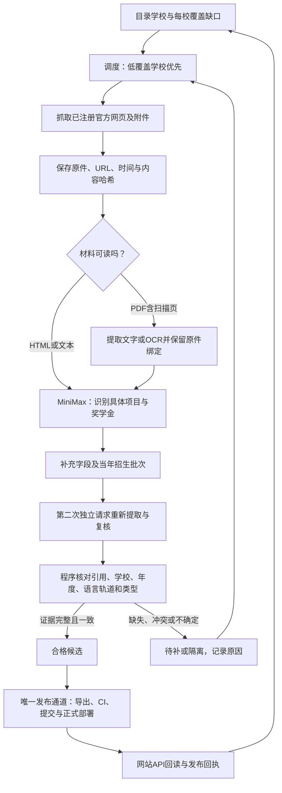

# MiniMax 多校项目与奖学金流水线

目标是增加有官方证据、申请条件齐备、可以在网站上核对的项目。衡量顺序为：
每校覆盖 → 有效申请信息 → 已确认上线成果 → 模型与云端资源效率。

## 数据如何流动

图中的待补记录只会在存在新的有效证据、明确可重试错误或经审核的操作时继续。
结果未知的已发送模型请求永久保留保护，不能靠重命名任务再次发送。

## 各步负责什么

| 步骤 | 输入与处理 | 可审查的输出 |
|---|---|---|
| 1. 学校排序 | 根据当前有效且申请条件齐备的不同专业数，按0、1、2–4、至少5排序；同档轮转 | 每校缺口与下一批学校 |
| 2. 官方采集 | 从已核验的学校官网入口读取页面，发现并按规则登记详情和附件；遵守域名与抓取限制 | 抓取结果及失败原因 |
| 3. 保存证据 | 原始网页/PDF存入R2，D1记录来源、学校关联、时间、哈希和任务状态 | 可复核的原件及来源链 |
| 4. 识别身份 | MiniMax识别具体专业、学位及明确命名的奖学金；目录标题不能充当项目 | 项目/奖学金身份候选 |
| 5. 补充事实 | 按来源补授课语言、申请资格、语言要求、材料、费用、期限、入口与当年招生批次 | 带逐字段原文证据的事实候选 |
| 6. 独立复核 | 第二次模型请求独立检查相同原始材料，再由程序比对 | 复核结果、差异与可定位引用 |
| 7. 校验和发布 | 验证类型、原文位置、学校、专业、年度、语言轨道、目标版本和重复记录；合格批次进入唯一发布通道及CI | 已审核候选、提交与发布记录 |
| 8. 上线确认 | 读取生产网站API，与本次发布内容和版本对应 | 已确认上线回执，再更新学校覆盖 |

R2保存文件，D1保存结构化记录和工作账本；模型只读取已经保存、可以追溯的材料。
MiniMax不自行联网浏览，访问官网由抓取程序完成。PDF先用Poppler提取文字，缺字页再用
Tesseract识别；独立图片和其他附件尚未通用自动支持，不支持或超出处理边界的材料保留待补原因。
项目身份与招生事实分开：找到了“计算机科学硕士”不代表已经证明其当年招生、语言要求或截止时间。
图中的身份、字段和批次是逻辑分工，不保证同批补齐。身份可以先独立发布，纳入目录并刷新
目标后，再按明确来源绑定补充字段和招生批次；同校共同政策仍需专业、学位、年度和轨道的适用证据。

独立复核通常仍使用同一模型的两次独立请求，第二次不看第一次答案。这是独立提取与比对，
不是独立厂商或人工审核；两次一致也不能保证正确，仍须原件、程序校验和争议隔离。

## 为什么学校可能有项目，却仍未达标

一所学校至少5个项目的目标，计算的是5个不同专业，并且具备官方来华招生证据、
具体学位、授课语言、有效年度批次、申请入口及有证据的资格和语言要求。
同一专业的中英文轨道分别保存条件，但不重复充当两个专业。
缺核心条件的记录进入待补队列，不计入达标。

奖学金有独立的身份及事实处理。国家级奖学金制度不能直接变成每所学校当年的
可申请机会；金额、覆盖、资格、年度、期限和入口分别绑定证据。

## 如何持续运行

现有GitHub任务每15分钟唤醒调度、处理附件和检查发布。Cloudflare上的队列、
Workers和数据库执行实际工作，Vercel提供网站及管理看板，本机可以关闭。

2026年11月16日的生产回读已确认连续补位启用。持久化协调器在任务完成后补入下一批，定时任务
继续负责兜底。抓取和模型有不同容量，避免大量网页抓取占满模型工作通道。
默认最多待处理8个模型任务、2个抓取任务；模型并发经过初始2任务验证后，已启用4任务上限。
每15分钟最多分配256个模型任务和64个抓取任务；这不是模型请求数或Token数。
一次任务可能需要提取、复核、多段处理，也可能在发送模型请求前等待。

第一轮保留扩充份额，避免维护旧记录长期挤占低覆盖学校；扩充内部按项目、项目、
奖学金轮转，空闲份额可互借。达到5个后把主要扩充资源转给其他缺口学校。
官方确实不足5个时，以完整目录核对证据记录实际情况。

新协调器、较小材料批次和失败重试必须经测试、部署和生产回读后才能称为上线。
方案、代码和模拟测试均不能代替生产运行证明。

已知同一项目的名称变体不能充当新增专业。对于已审定对应关系的官方页面，未映射的新名称
进入待复核；其余合格字段和奖学金候选仍走唯一发布通道。运行状态及实际新增以看板和上线回执为准。

## 看板应该回答的问题

- 当前订阅窗口还剩多少额度，是否等待刷新或限流？
- 模型是否有正在执行、排队和可以处理的材料？空转具体卡在哪一步？
- 采集了多少原件、调用了多少次模型、多少成功、失败或结果未知？
- 各校有效项目处于0、1、2–4、至少5哪一档？有有效奖学金的学校有多少？
- 本批新增候选、已审核记录、有效事实和已确认上线记录分别是多少？

尽量用满订阅额度依靠更多有价值材料和及时补位；当前配置保留5%订阅余量，
有紧急维护任务时保留维护份额，独立复核请求仍逐次检查准入。
不购买额外积分、不切换到额外付费模型通道。两次模型检查仍可能共同犯错，
所以必须同时保留原件、程序校验及对争议材料的隔离。
