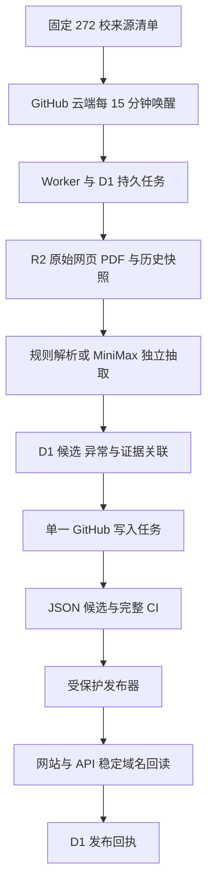

# 272 校目录与自动维护

系统的目标是让每所学校的官方国际招生项目都能被发现、逐项核对，并在后续招生季保持可靠。目录收录、当前可以申请和实际发布是三个独立状态。程序部署成功只说明维护能力已就绪；学校的实际检查和目录对账仍须用运行证据验收。

## 目录与当前申请信息

项目名称、学校、学位和官方入口组成稳定身份。招生年度、入学季、费用、截止日期及奖学金条件随时间变化，分别保存核验凭据。旧的核验过期后，项目目录入口继续存在，动态字段显示待核实。只有已被接受的身份能进入目录；原始记录的 stale 状态不能自动变成身份认证。

新年度发现器会为已接受的项目寻找明确的招生年度和入学季，以“项目、学年、季节”创建独立轮次。两次独立抽取必须指向同一个具体项目，并提供名称、学位、国际招生范围和日期的原文证据；学校面向所有专业的模糊年份公告不能替代项目证据。新轮次使用单独字段凭据，旧项目和历史轮次的审计时间保持不变。

所有页面与公开接口共用白名单投影。投影只组装允许展示的字段，不把完整原始记录展开给前端。因此搜索、对比、收藏、结构化数据和 SEO 不会意外重新露出旧费用或资格文本。原有当前记录 API 保留含义；新增 `/api/v1/directory/institutions`、`programs` 和 `scholarships` 提供目录视图。目录分页游标绑定内容版本和中国日历日期，跨日过期后旧游标失效。

发布信息分别提供 `directoryCounts`、兼容原统计含义的 `currentFactsCounts`、可识别新字段凭据的 `currentOpportunityCounts` 和学校覆盖数 `schoolCoverageCounts`。当前机会只计明确开放、即将开放或滚动申请的轮次；仅列出日期但尚不能判断开放状态的记录另行保留，不冒充开放机会。

## 数据如何流动

D1 是任务和处理状态的数据库，保存租约、候选、来源检查及回执。R2 是对象存储，保存原始文件和不可变解析结果，方便复核与重新解析。Git 中的规范 JSON 继续决定网站事实版本。这种分工让采集失败不影响网站，也让候选审核通过与网站真正发布分开核算。

Worker 使用独占租约防止同一个任务被两个消费者执行。全局协调器是单个 Durable Object，它将同一账户的准入状态集中保存，限制最多八个抓取任务、每个域名一路，以及从两路逐渐增长到四路的模型请求。用集中准入可以避免多个 Worker 实例各自放行而叠加超额。

## 如何补齐学校项目

固定范围来自 `content/maintenance/scope-272.v1.json`。来源按本科、硕士、博士、非学历和奖学金分类；同一 URL 只抓取一次，但保留全部类别并独立处理项目与奖学金，避免一类失败阻断另一类。

每个候选包含官方 URL、原文件哈希、R2 对象、原文位置、引用及独立核查结果。专业身份优先匹配学校、官方代码与学位；没有代码时匹配原始名称和学位，歧义进入复核。招生年度不进入身份键。重复导入保留已有 ID 和 slug，不删除旧项目，不批量续期历史字段。

文本 PDF 通过 Poppler 提取保留页边界的文本；扫描页使用 Tesseract OCR。原始 PDF 和派生文本各有哈希，必须能回到相同原始文件。超出页数、正文长度或解析能力的文档进入异常队列，不能通过截断标记为完整。

每校对账分两层：首轮排查必须有实际结果、证据和下次处理时间；完整对账必须解释官方目录中的全部条目、分页、附件和排除项。`scripts/maintenance/reconciliation.ts` 对缺页、未解释条目和代表性样本保持未完成。来源抓取成功不能替代逐项对账，学校关联也不表示奖学金适用于全部专业。

五校试点出现真实首检结果，并完成至少一次带稳定域名证明的发布后，调度器才允许每批增加最多二十校。每批新学校都需要真实检查或明确受阻结果，才能继续下一批。272 校均有首检结果后进入全范围维护；未完成目录核销的学校仍保留待处理状态。人工暂停、未知模型请求、未决发布或租约冲突都会阻止自动扩大范围。

认证后的 `/schools` 接口提供每校真实检查时间、成功与受阻来源、证据快照和下次到期时间。`/reconciliations` 保存逐项核销报告；标记完整还需要一份事先独立保存、绑定整个报告和原始快照的人工复核回执。来源、规范版本或维护对象变化会使旧的完成证明失效。数据库不可访问时，实际处理数量显示未知。

## 自动更新和套餐保护

到期任务通过云端队列执行。临近七日截止的字段每日检查，四十五日内每三日，其余当前申请信息每七日；目录发现每三十日，稳定介绍每九十日。相同正文可复用模型输出，但仍需新的真实来源检查，且只续期实际核实的字段。

模型只使用当前 MiniMax M3 的官方 Anthropic 协议和服务端订阅 Secret。每次发送前检查官方五小时和每周额度，额度未知或认证异常时暂停模型任务，保留抓取能力。额度不足等待重置；限流降低并发。系统保留余量保护，不购买套餐、不启用按量密钥，也不修改账户的额外计费设置。

发送前持久记录预留；发送后丢失结果的请求保持 unknown，自动化不会重发。历史 STOP、已消费和未知请求按原学校、父项目、来源和快照范围保留。招生轮次同时绑定父项目 ID，避免子任务绕过父项目保护。

## 发布与故障恢复

普通候选每两小时合并一次，已核实的七日内临期变化优先。GitHub 写入任务与旧写入任务共用互斥锁，候选基于精确父版本生成。官方证据、年度范围、字段、关联、目录完整性和页面检查通过后，先运行完整 CI，再将经过测试的同一提交交给现有保护发布器。

完整校验后确认同一身份及相同官方入口没有语义变化的候选会记为 unchanged 并消化，不改写身份日期或重建网站。CI 和新发布任务使用 `validate:data -- --directory-safe-expiry`，该模式强制运行完整目录证据校验，允许原始记录随着日历自然过期；手工数据编辑默认仍采用严格状态校验。这个模式不修改原始事实，也不改变公共过滤规则。

候选部署失败时稳定网站保持原版本。写入竞争时停止并重新对账，不把未测试的重定基版本推送上线。身份合并、批量删除、异常幅度变化和冲突进入复核。官网暂时不可访问不会自动删除项目。

应用回执只表示规范 JSON 已提交。发布回执还必须确认 Vercel 稳定域名指向同一提交，并完整读取目录 API 与相关页面。回执响应丢失时复用同一不可变证明；恢复任务优先完成已应用但未确认发布的旧批次，再处理新批次。

## 部署现状与验收

2026 年 10 月 25 日的安全投影包含 255 所学校、783 个项目身份和 7 个奖学金身份；兼容旧接口口径的当前有效项目为 779、奖学金为 0。目录基线来自已接受的生产版本，迁移只保留身份，不续期旧奖学金金额和条件。272 校的原始范围包含被当前发布规则保留在后台的学校，不能直接全部宣称公开可用。

云端已创建独立维护队列、失败队列和 `maintenance_*` 表，Worker 与 Secret 已配置。账户已有五个 Cloudflare 免费定时触发器，因此采用 GitHub 云端十五分钟调度。D1 免费日读取额度在部署时已耗尽；初次学校队列必须在账户额度恢复后成功初始化并实际执行，才能进入五校贯通验收。所有自动恢复仍受固定来源范围、历史保护和五校试点开关限制。

10 月 25 日复核时，共享 D1 读取额度仍已耗尽。过去七天的查询分析显示，旧发布构建器的一条全量证据查询平均每次读取约 710 万行；免费额度是每天 500 万行。当前补丁保持证据筛选和输出不变，固定为沿现有索引正向关联。真实读量是否下降、当天资源是否够用，必须在额度恢复后回测，不能仅凭本地执行计划认定已解决。[D1 计费和配额说明](https://developers.cloudflare.com/d1/platform/pricing/)

维护服务已经通过私有、限长并脱敏的诊断快照确认该错误的原文确实为每日读取限额耗尽；通用的 `7500`、缺表和 SQL 错误不会再误报为正常配额等待。诊断对象只在认证后的管理接口可取，公开接口不返回内部错误文本。

备份验收仍有明确缺口：GitHub 仓库缺少 `CLOUDFLARE_D1_BACKUP_TOKEN`，受保护恢复环境也没有 `CLOUDFLARE_D1_RESTORE_TOKEN`，最近两次每日备份均失败。现有备份器会自动包含新增维护表，但凭据配置、真实导出、R2 哈希回读和隔离恢复都成功之前，不能声称备份可靠或满足恢复目标。不得把本机 Wrangler 登录凭据复制成云端长期备份密钥；应按[专用备份权限说明](../backup-and-restore.md#github-actions-configuration)配置最小权限 Secret，密钥不要进入仓库或聊天。

验收分别记录：272 校首轮实际状态、可访问官方目录逐项对账、当前字段可信度，以及连续七天调度、恢复、发布和备份证据。原始记录数量只作辅助指标。七天观察期从真实启用后开始，不能用单次测试或本地模拟替代。

具体 Worker 配置、端点、启停和恢复命令见 [运行手册](../../workers/catalog-maintenance/README.md)。
