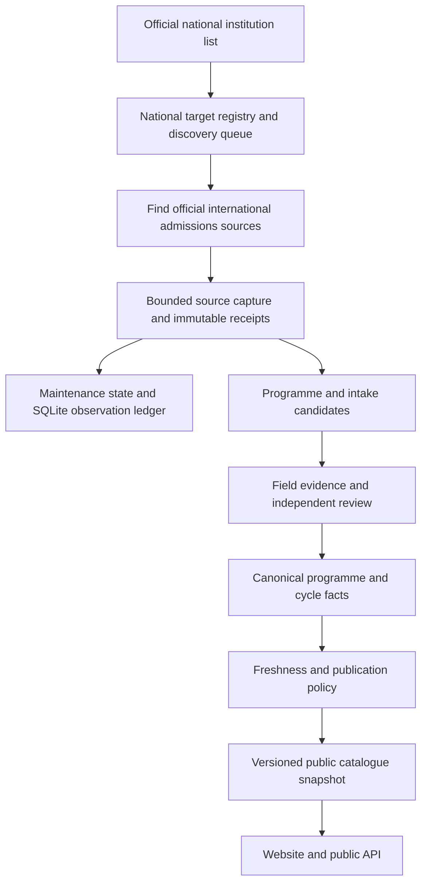

# Nationwide international admissions coverage and continuous maintenance

> Latest recovery and batch status: [18 October handoff](map-program-recovery-2026-10-18.md) and `quality/recovery-20261018/continuation-state.json`. These supersede historical workspace paths, automation status and current-version/count pointers below. Use the restored primary checkout for Git operations; the old managed worktree's Git pointer is broken.

## Product goal and completion criteria

The product helps prospective international students find study programmes in China and understand whether, when and how they can apply. A university identity on a map is only a starting point. Two manually corrected universities do not meet the nationwide requirement.

The authoritative mainland institution universe is the Ministry of Education's 2026 list, published 18 June 2026, as of 17 June 2026: **3,196 institutions**, including 2,952 general institutions (1,412 bachelor-level and 1,540 higher-vocational/junior-college institutions) and 244 adult institutions. Its stated scope excludes Hong Kong, Macao and Taiwan. Listing an institution does not establish international-student admission eligibility. Adult/vocational institutions must remain identifiable and individually investigated rather than silently excluded or advertised as accepting international applicants.

Official source: <https://www.moe.gov.cn/jyb_xxgk/s5743/s5744/202606/t20260618_1441074.html>.

`content/targets/national-university-registry.json` is the operational target universe. It is not the public factual university collection. Its deterministic discovery queue includes every institution. Exact Chinese names match 271 existing catalogue identities; a separately evidenced Shanghai Sport University rename links the remaining identity. There are 272 linked identities and **2,924 institutions absent from the existing university collection**. Unknown admission availability remains unknown.

For each institution, eventual completion means reconciling its official international admissions catalogue against the collected programme identities, levels, teaching languages and intake cycles. A single current programme is not proof of catalogue completeness. Record the official catalogue version/year, discovered rows, reviewed rows, excluded domestic-only rows, unresolved conflicts and missing evidence. Closed intakes remain historical evidence; do not roll their dates forward.

## Architecture and responsibilities

The registry answers “which institutions have we not investigated?” The operational ledger answers “what did we actually check, and what happens next?” The factual catalogue answers “which claims have official evidence?” Keeping these separate prevents a successful download from silently certifying old requirements, fees or deadlines.

The current bounded collector covers all 255 publicly visible map universities and separately reports 17 withheld local identities. The national registry extends the target universe beyond those 272 existing identities. Unregistered sources for the additional institutions require official-source discovery and normal review before capture; the collector does not guess domains or invent admissions facts.

## Actual factual changes in this release

- Two existing GDUFS bachelor programme identities now have independently reviewed spring 2027 admission cycles, complete official-source eligibility/materials, application fee and tuition conditions. These are two programme updates and two new cycles, not two newly discovered degree identities.
- The application period is 30 September–10 December 2026, academic year 2026–2027. Official Chinese/English notices and original fee/CSCA image bytes support the accepted fields. Conflicting age/CSCA timing and a stale minor-date statement are disclosed; do not silently select the more convenient wording.
- Overdue verified records were marked stale without extending evidence/review dates: four programmes, four cycles and four scholarships. Runtime publication also enforces freshness and inclusive China-calendar deadlines.
- A partial/name-only deterministic extraction can now produce held proposals only. It cannot renew a whole programme, merge an old intake into a new one or write an unsupported current cycle.
- Universities without current verified programmes now explain that coverage is pending, offer the official source and accept missing-programme feedback in all six public languages.

The frozen release contains 272 raw universities, 2,035 raw programmes, 1,626 raw cycles, 396 raw scholarships and 2,556 sources. On 17 October 2026 the public projection is 255 universities and 755 programmes/cycles across **seven universities**. The other **248 visible universities still have zero current verified programmes**. This is a coverage deficit, not evidence that those universities have no programmes.

SYSU remains pending: the observed international admissions host blocked acquisition, and a readable official preparation-programme notice had an already closed July 2026 deadline. Neither that closed notice nor an indexed snippet qualifies as a current admission record. The GDUFS discovery adapter also found graduate and domestic-only catalogue candidates; those candidates were not automatically published.

Evidence-handling incident: after the initial GDUFS batch had been applied, its working batch JSON was overwritten during preparation of the additional entrance-examination condition. The original application receipt and original source captures were preserved; the overwritten snapshot, disclosure and a labelled semantic reconstruction remain under the GDUFS evidence directory. The reconstruction is not claimed to be the original bytes. The separately named `full-program-batch-v2.json` has its own batch ID, current-parent review and application receipt and is the final consumed correction. Do not overwrite or replay either consumed batch.

## Runbook and continuity

Read `docs/operations/university-maintenance-planner.md` for the exact plan → capture → SQLite mirror → scheduling-receipt sequence. In particular, mirror the original plan and its report before advancing state. Plan hashes, catalogue hashes, dates, selected IDs and state revisions must match. Preserve interrupted markers and owner locks; do not erase them to retry.

The current local sweep uses `.tmp/university-maintenance/current-state.json` and `.tmp/university-maintenance/maintenance.sqlite`. Complete runs preserve their original `plan.json` beneath `.official-harvest/university-maintenance/<planSha256>/`, plus bounded original bytes, report, results and completion hashes. Source observations and link candidates remain unverified. Acquisition uses at most twenty universities, two URLs per university, two concurrent workers, domain throttling, robots policy, exact hosts and socket-time public DNS checks. Persistent URL offsets rotate the next pair rather than repeatedly selecting only the first sources. Legacy receipts lacking an offset retain their original scheduling meaning; do not alter their hashes.

The first two nationwide discovery batches also investigated **twenty bachelor-level institutions absent from the existing 272 identities**, selected in MOE order without repeats. Thirteen had primary official source candidates, five remained unknown and two were blocked (BFA HTTP 412; BUU HTTP 403). These were source-discovery observations with zero raw-byte captures and zero certified programmes, not additions to the public catalogue. Undated/restricted guidance, historical 2010/2023 notices and already closed 2026 windows remain labelled. Immutable reports live under `quality/continuous-program-maintenance-20261017/national-discovery/`; the registry runbook selects future targets by scanning all completed receipts and preserving their exact hashes.

The all-map first pass subsequently completed at **06:09:17 UTC**: 255 distinct visible universities, thirteen finite capture batches and 507 source observations (369 captured, 22 unchanged, 27 blocked, 89 failed). There are 214 schools with material pending review and 41 held. The 2,108 distinct discovered URLs remain candidates. JSON state is revision thirteen, the terminal plan has zero eligible/selected schools and no capture/state locks remain. See [the full source-sweep audit](./all-map-source-sweep-2026-10-17.md) for reproducible SQLite queries, missing/duplicate checks, failure reasons and durable evidence paths. This source pass performed zero fact certifications, canonical/cloud writes or publications; it is separate from the reviewed GDUFS release.

`.github/workflows/university-program-maintenance.yml` prepares one source-only batch each hour. It requires default-branch installation before GitHub cron becomes active. A branch push/PR does not enable the schedule, and a new manual workflow may also require default-branch registration. GitHub cache is an evictable, repository-accessible continuity aid, not private evidence storage or a durability guarantee. No applicant documents, credentials or cookies belong in it. Raw public-source bytes are cached with their matching state and closed ledger; uploaded inspection artifacts use a narrow allowlist.

The existing local fifteen-minute heartbeat should continue the national backlog and review completed source batches once the interactive writer releases ownership. Reuse the existing automation rather than creating duplicate canonical writers. Each run must read the latest handoff and real current state, process finite batches fairly, and report only meaningful progress, failures, completion or required user action. An unchanged healthy poll stays quiet.

Actual automation readback now confirms existing ID `studyinchina-minimax` is **ACTIVE**, renamed “StudyInChina 全国高校项目持续核验与更新”, retaining its fifteen-minute cadence and existing target chat. The new durable prompt is 10,643 characters, SHA-256 `0cfddf35c455df564e8f59510906f2f9a08b01376e80fc2c412c1e08d26f0868`; it prepends the completed source sweep, national first-pass/retry/review queues and current PR, while preserving the historical paid STOP/unknown scopes. No duplicate automation was created. Local-file scheduled work requires the computer and desktop app to remain running, as documented in [official OpenAI scheduled-task guidance](https://learn.chatgpt.com/docs/automations?surface=app).

Use the attached worktree `C:/Users/Henry/.codex/worktrees/all-university-maintenance/StudyInChina` and its clean locked dependencies for code checks. The original root workspace's installed Next version was 16.3.5 despite a 16.3.8 package/lock declaration; it was deliberately not reinstalled over unrelated ongoing local work. The isolated worktree installed the exact final lock and passed on Next 16.3.8. A frozen website source release must use its qualified dependency install; never deploy the entire dirty root or treat an old root installation as the declared version.

## Database and publication limits

The local maintenance SQLite ledger is an observation/query mirror; JSON scheduling state remains its execution authority. Separately, a local factual database built with the existing D1 catalogue migrations contains the canonical release, with clean `foreign_key_check` and `integrity_check`. Its immutable receipt lives under `quality/continuous-program-maintenance-20261017/database/`. It includes held/stale history and performs no cloud activation.

The actual Cloudflare D1 API returned error 7500 (free-tier daily row-read limit exceeded). Do not repeatedly retry or purchase capacity. Earliest ordinary daily-reset retry: **18 October 2026 00:00 UTC / 08:00 China time**. A failed quota request does not prove a database is empty. GitHub currently lacks `CLOUDFLARE_API_TOKEN`; do not copy an interactive OAuth login into a repository secret. The frontend remains on its existing JSON delivery path until a qualified database release and independent readback permit a deliberate cutover.

Preserve the existing `ambiguous_paid_outcome` STOP, consumed/unknown paid scopes, budgets, owner locks and original receipts. This work authorizes national maintenance; it does not reset an ambiguous paid call or authorize repeated charges. Official-source preparation and independently evidenced manual review can progress without paid model calls. Keep acquisition, candidate creation, fact approval, canonical writes, cloud writes and public publication as separate reported counts.

Website releases are built from the pinned already-published baseline plus explicit task overlays, not from the entire dirty working tree. Candidate readiness is followed by all-map-page/API/locale/browser checks, then the shared guarded deployment writer and stable-alias readback. The former production version remains registered for rollback. GitHub work uses the attached isolated branch `codex/all-university-maintenance`; unrelated local experiments and private operational artifacts are excluded.

Actual production promotion completed **17 October 2026 05:48:51 UTC** through the shared writer: current deployment `dpl_EzmeTYs6kFzVda3vaWNWVXsmVC7F`, previous deployment `dpl_9cDXyRNRAZoit9TNuwQLigSsApEz`. The publisher checked all 255 candidate university pages, all 755 API programme identities, required conditions on the two changed programmes, six-language pending/available states, unpublished-record 404s, desktop/mobile geometry and the city → university → programme browser path. The immutable candidate receipt has nineteen checks, two full changed-programme detail checks, 255 university page checks and zero browser errors. Stable-domain readback is an additional receipt rather than an inference from candidate readiness.

Stable-domain readback also passed nineteen checks and the two changed-programme detail checks, confirming 255 public universities, 755 public programmes/cycles, 696 referenced public sources and zero browser errors. The previous version remains the recorded rollback target.

Task validation passed 147 focused tests plus sixteen national-registry tests, full TypeScript checking, scoped strict ESLint, strict data validation and a production webpack build on the locked Next.js 16.3.8 dependency. The whole unit suite is not green: its initial run reported 1,375 passed, 104 failed and one skipped. The isolated branch preserves the exact previously published source baseline as a separate commit, and existing tests contain contracts from older catalogue/publication behavior. Baseline attribution is being checked separately; do not attribute every failure to the new task or claim CI success. The strict per-university programme-coverage gate also remains unmet while 248 visible schools have zero current records. Keep the pull request in draft and retain the quality gates.

Independent baseline comparison subsequently reran all 45 failing files (328 tests) against a clean archive of the preserved production baseline commit `81c8892`: exactly the same 104 test identities failed, 224 passed, and the new task introduced zero newly failing identities. The comparison proof is `.tmp/university-maintenance-baseline-comparison.json` in the isolated worktree. This establishes attribution, not a green suite: the old tests and coverage deficit still need resolution before default-branch integration.

The first real PR CI run stopped even earlier at its production dependency audit: [sharp/librsvg advisory](https://github.com/advisories/GHSA-wq5f-xc86-pv6w) and [source-map-js advisory](https://github.com/advisories/GHSA-68fv-2mgg-jv7q). The minimal repair pins sharp 0.35.5 and source-map-js 1.2.2 while retaining Next.js 16.3.8. Miniflare's exact sharp 0.35.4 dependency shared the hoisted image library with Next, so the existing Miniflare-specific overrides add only `sharp: 0.35.5`; no broad framework upgrade or audit suppression was used. After a clean install, the official npm production audit reported zero vulnerabilities. All 163 targeted tests, full type checking, the production build, real Next image optimization across four formats, benign SVG rendering and source-map compatibility/bounds checks passed. Proofs are in the isolated worktree's `.tmp/security-dependency-*.json` files. The local npm mirror's unsupported audit endpoint was avoided with an explicit official-registry flag, without changing user npm configuration.

Security-release preparation encountered a Windows dependency-junction permission failure. An upload was mistakenly started before the frozen plan existed; `dpl_GeEP1MvSF53eBzBVFxvYpGAXUe1T` is explicitly held and unqualified, with no production alias mutation. All 599 files were then checked against their expected bytes, the source plan was successfully frozen, and a distinct deployment `dpl_LDLBuyeSdaCx1ewix5adWE51qKYf` was created afterward for normal qualification. The former upload is preserved and must not be promoted merely because its build becomes ready.

The qualified security candidate passed the full 255-page/755-programme API and six-language/mobile browser checks, then the shared guarded writer confirmed its production promotion at **06:11:44 UTC**. Latest current deployment is **`dpl_LDLBuyeSdaCx1ewix5adWE51qKYf`**; immediate previous is **`dpl_EzmeTYs6kFzVda3vaWNWVXsmVC7F`**. These supersede the first promotion's current/previous pointers above. Actual Linux PR CI also confirmed the production audit found zero vulnerabilities. Its next lint warning in the legacy no-op badge was corrected without changing the component's signature or null rendering; full isolated lint then passed. The root workspace had a different, already clean badge implementation and was left untouched. National target JSON now has explicit LF checkout rules, independently verified with a temporary Git index and `core.autocrlf=true`; original target hashes remain stable.

## Business sequencing

The first audience is prospective international students. The immediate acquisition promise must match measured coverage. Broader promotion should follow useful, current coverage for initial student segments and clear disclosure of the remaining backlog. The free product needs trustworthy discovery, filters, official evidence and application timing first. Paid CV/profile-to-programme analysis should be evaluated later against actual eligibility evidence, user demand and inference costs; a generated score without reliable catalogue coverage would amplify existing gaps. See `docs/growth/` for the first-cohort and commercialization documents.

## 06:28 UTC finite follow-up

See [the immutable-source follow-up handoff](national-maintenance-heartbeat-2026-10-17T0628Z.md): ten additional national identities investigated (five official sources, four unknown, one blocked URL), oldest twenty map schools triaged with no complete factual approval, and absent admin/publication lock owners observed without restart. Three national batches now cover thirty missing identities; all paid/canonical/cloud/publication deltas are zero.
