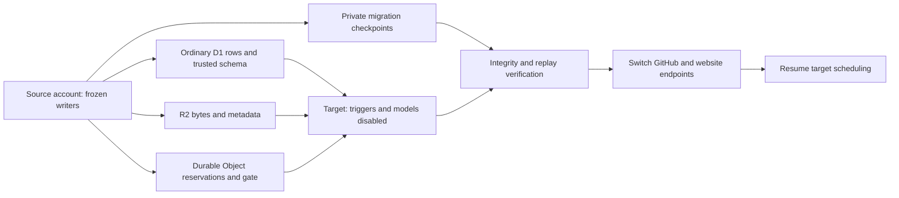

# ADR: Move StudyInChina to the owner's paid Gmail Cloudflare account

Status: accepted account choice; execution pending authenticated target access
and verification. The owner explicitly selected migration instead of purchasing
a second subscription on the existing account.

## Context and decision

The deployed project belongs to account `78969c65bfdd892bb12c116869ea91cf`.
The owner purchased Workers Paid on Gmail account
`b75f28d574289c29e9bda60a2fca27ed`, which has no project resources yet.
The project will move to that account while retaining existing business IDs,
official evidence, hashes, publication history and model execution protections.
No second paid plan is required by this migration. Usage-based charges remain
subject to the destination plan; the owner requested proceeding without the
previous automatic dollar budget gate.

## State that cannot be recreated from catalogue records

The two D1 databases include workflow state as well as catalogue data. Preserve
every ordinary table, current release pointer, controls/revisions, scope upgrade
proofs, reservations, unknown outcomes and acknowledgements. Create the target
schema from the repository's trusted migrations; import ordinary rows while
transition triggers are disabled, then restore triggers and rebuild FTS.
An export in SQLite-only compatibility mode is not a D1 restore artifact.

R2 object keys, bytes, HTTP metadata and custom metadata must match. This
includes source evidence, model outputs, partition/frontier cursors, native-head
proofs, operational recovery markers and admin release/executor records, not
only public release files. Copy is non-destructive and resumable. ETag equality
does not substitute for SHA-256 and metadata verification.

ModelAdmission stores authoritative `request:*` reservations in Durable Object
KV, including a legitimate DO-before-SQL crash window. A new empty namespace
cannot safely resume calls merely because SQL and R2 were copied. Add an
authenticated, disabled-by-default transfer protocol with a persistent source
freeze, complete paginated export, target import into an empty or identical
checkpoint, and full hash/count finalization. Preserve every unknown and
send-started reservation. Allow already-running work to settle before exporting;
never run source and target model writers simultaneously.

Cloudflare resource IDs are recreated: database UUIDs, queue IDs, DO namespaces,
version/deployment IDs and the workers.dev hostname change. Domain record IDs,
source/job/reservation IDs, release IDs and historical receipts do not change.

## Execution and verification

1. Create a separate `studyinchina-gmail` OAuth profile, explicitly bound to the
   target account for all target commands. Retain the original default profile.
2. Inventory live variables, secret names, triggers/consumer settings, resources,
   frontend backend mode and GitHub workflow states. Do not print secret values.
3. Before the final capture, freeze all source writers and queue delivery without
   changing business control revisions. Keep `CATALOG_MAINTENANCE_MODE=cloud`;
   changing it can activate a legacy writer. Queue retention is finite, so use
   durable ledger-based recovery rather than treating paused messages as backup.
4. Prepare and verify private D1, R2 and DO migration checkpoints. Preflight
   exports taken before the freeze remain explicitly non-cutover-ready.
5. Create destination databases, buckets, queues and seven workers with models,
   crons and consumers inactive. Import state and reconstruct only safely
   recoverable durable messages; never replay unknown model outcomes.
6. Configure a new maintenance/admin credential set. The owner must safely
   re-enter `MINIMAX_SUBSCRIPTION_KEY` on the destination maintenance Worker;
   deployed Cloudflare secrets are not readable migration data. Keep the
   existing M3 model, subscription endpoint and automatic-credit margin policy.
7. Require foreign-key and integrity checks, exact ordinary-table summaries,
   scope/version validation, all R2 SHA/metadata checks, DO manifest verification,
   completed-request reuse and unknown-request rejection with zero model sends.
8. Prove target D1 reads/writes through its actual Worker binding. Archive the
   old active quota wait via the existing recovery operation. An old account's
   cached quota result cannot classify the destination account.
9. Switch GitHub account/URLs/tokens and any actually configured website API/host
   pins. Preserve the website's JSON/D1 backend choice. Resume target scheduling
   only after all checks pass, then verify a real model/candidate/publication
   receipt. A green migration job is not catalogue growth.

The source account remains intact and frozen until cutover is proven. Rollback
first stops target writers, restores source endpoint/credential settings and
validates the original checkpoint before explicitly reopening source execution.
Do not delete either account, database, namespace or evidence bucket as part of
the initial migration.

## Trade-offs and references

This avoids a second subscription but costs additional operational work and a
controlled processing pause. It requires new account credentials and a stateful
DO transfer, rather than a simple database copy. Private temporary R2 transfer
workers can avoid requesting additional long-lived S3 credentials; they must
enforce fixed peers, bounded objects, authentication and byte verification.

- [Wrangler authentication profiles](https://developers.cloudflare.com/workers/wrangler/profiles/)
- [D1 export virtual-table compatibility](https://developers.cloudflare.com/changelog/post/2026-11-12-d1-export-virtual-tables/)
- [Durable Object migration boundaries](https://developers.cloudflare.com/durable-objects/reference/durable-objects-migrations/)
- [R2 migration options](https://developers.cloudflare.com/r2/data-migration/)
